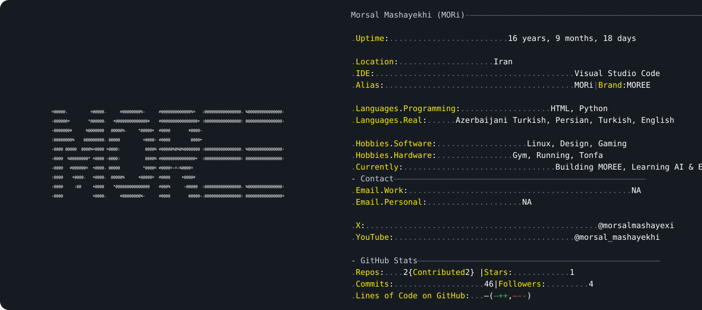

<!-- PROFILE HEADER -->
<p align="center">
  <picture>
    <source media="(prefers-color-scheme: dark)" srcset="dark_mode.svg">
    <source media="(prefers-color-scheme: light)" srcset="light_mode.svg">
    
  </picture>
</p>

## INFO

```text
Name                  : Morsal Mashayekhi (MORi)
Uptime                : <!-- UPTIME:START -->Calculating...<!-- UPTIME:END -->

Location              : Iran
IDE                   : Visual Studio Code

Alias                 : MORi
Brand                 : MOREE

Languages.Programming : HTML, Python
Languages.Real        : Azerbaijani Turkish, Persian, Turkish, English

Hobbies.Software      : Linux, Creative Design, Gaming
Hobbies.Hardware      : Gym, Running, Tonfa

Games                 : Cyberpunk 2077, Watch Dogs 2
```

## CURRENTLY

```text
Building : MOREE
Learning : Artificial Intelligence, English
Studying : Computer Science
```

## CONTACT

<p>
  <a href="https://x.com/morsalmashayexi">X · @morsalmashayexi</a>
  &nbsp;|&nbsp;
  <a href="https://www.youtube.com/@morsal_mashayekhi">YouTube · @morsal_mashayekhi</a>
</p>

<!-- Work email, personal email, and LinkedIn profile link can be added when provided. -->

## GITHUB STATS

<p align="center">
  
  
</p>

---

<p align="center">
  <b>MORi × MOREE</b><br>
  <sub>Build. Break. Learn. Repeat.</sub>
</p>
